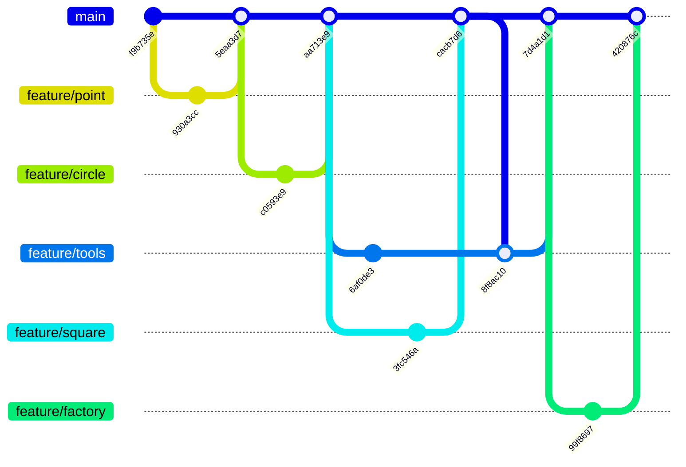
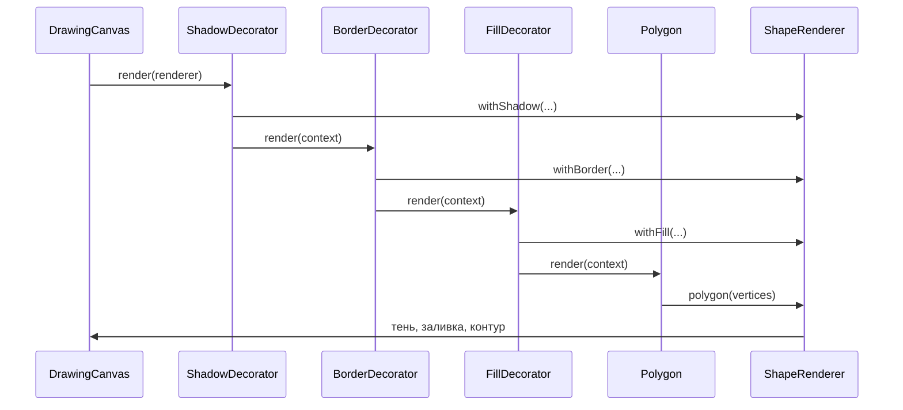

# GraphicEditor

Учебный графический редактор на JavaFX. В основной опубликованной ветке
завершён первый инкремент. Локальная ветка codex/increment-2 добавляет
векторные полигоны к растровому рисованию.

Возможности: реализованы точка, круг и квадрат; добавлены инструменты
создания графических элементов, выбор цвета и размера кисти, очистка холста.

Размер круглой/квадратной кисти — от 1 до 100 пикселей. Точка — 1 пиксель.
Выбор цвета влияет на новые штрихи, уже созданные элементы сохраняются.

Для запуска нужен JDK 25:

```sh
./mvnw javafx:run
```

Проверки модели и контроллера: `./mvnw test`.
Все проверки, включая JavaFX (нужен рабочий стол):
`./mvnw -DexcludedGroups= clean verify`.

Первый инкремент был реализован локально до выполнения Git-практики.
Исходная история сохранена. Ветки feature/point, feature/circle,
feature/square, feature/tools и feature/factory используются для настоящих
доработок, проверок и изучения PR, review и слияния. Они не выдаются за
историю первоначального написания уже готовых классов.

## История Git-практики

Схема соответствует реальным коммитам и слияниям:



Каждая ветка прошла Pull Request и самопроверку кода. Конфликт README
между feature/square и feature/tools возник при настоящем слиянии и
разрешён коммитом 8f8ac10. Review одним автором оформлен комментарием:
GitHub не позволяет одобрить собственный Pull Request.

## Второй инкремент

В режиме «Полигон» задайте не менее трёх вершин кликами и нажмите
«Завершить полигон» или Enter. «Отменить вершины» или Escape сбрасывает
черновик. Выберите созданную фигуру в списке, настройте независимые
заливку, контур и тень, затем нажмите «Применить оформление».
«Удалить полигон» удаляет выбранную фигуру. «Очистить холст» удаляет
растровые и векторные элементы. Кисти первого инкремента продолжают работать.

Polygon хранит геометрию. ShapeDecorator оборачивает Shape, а FillDecorator,
BorderDecorator и ShadowDecorator передают вызов дальше с дополненным
контекстом ShapeRenderer. После обхода цепочки тень, заливка и контур
отрисовываются в стабильном порядке независимо от порядка обёрток.



При совместной работе растровый слой находится под полигонами.
Для инструментов предусмотрены всплывающие подсказки.
Сохранение, загрузка и Undo/Redo относятся к третьему инкременту
и здесь не реализованы.
