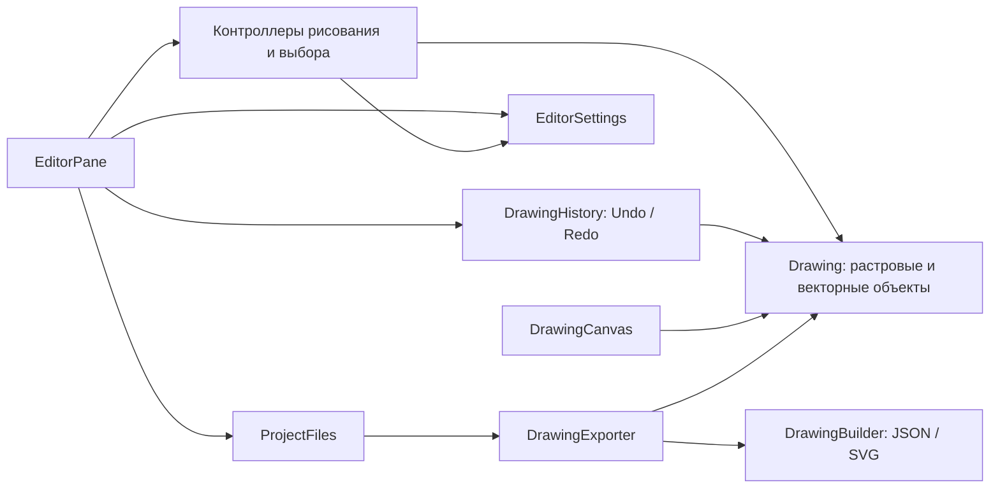
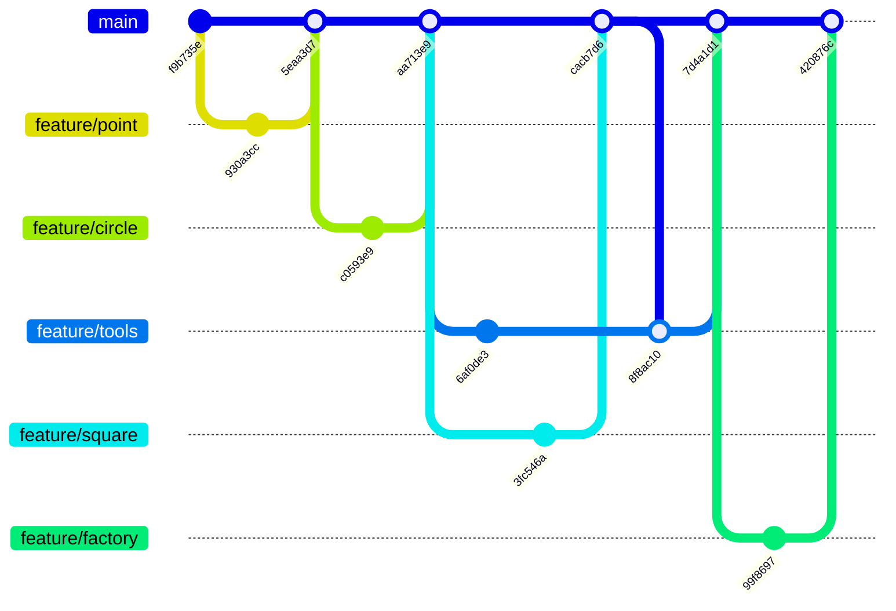

# GraphicEditor

Учебный графический редактор на JavaFX, итоговая версия **1.0.0** по
[заданию из трёх инкрементов](https://github.com/olgmina/SWEngineering-technics.github.io/blob/gh-pages/Labs/prTask_GraphEditor.md).
Растровые элементы и оформленные полигоны входят в единый рисунок;
их можно выбирать, перемещать, удалять, сохранять и открывать для дальнейшего
редактирования. Изменения рисунка поддерживают Undo/Redo.

## Версии и запуск

| Ветка | Версия | Содержимое |
|---|---|---|
| [`increment1`](https://github.com/PROCuuuba/GraphicEditor/tree/increment1) | 0.1.0 | Точка, круглая и квадратная кисти, цвет, размер, очистка |
| [`increment2`](https://github.com/PROCuuuba/GraphicEditor/tree/increment2) | 0.2.0 | Первый инкремент и полигоны с заливкой, контуром и тенью; без сохранения и открытия |
| [`increment3`](https://github.com/PROCuuuba/GraphicEditor/tree/increment3) | 1.0.0 | Единый рисунок, выбор объектов, Undo/Redo, настройки, PNG, JSON, SVG и GED |

Переключение: `git switch increment1`, `git switch increment2` или
`git switch increment3`. Сохраните собственные изменения перед переключением.
Ветки соответствуют этапам задания; файловые операции находятся в третьем.

Нужен **JDK 25** и графический рабочий стол. JavaFX **21.0.6**, JUnit **5.12.1**
и Maven **3.8.5** загружаются через зависимости и Maven Wrapper.
В IntelliJ IDEA выберите JDK 25 и импортируйте `pom.xml`.

```sh
./mvnw javafx:run
```

На Windows используйте `mvnw.cmd javafx:run`. Проверки без окон:
`./mvnw test`. Полная проверка с GUI и регрессиями всех инкрементов:

```sh
./mvnw -DexcludedGroups= clean verify
```

После переключения ветки используйте `clean`, чтобы убрать классы другой
версии. Покрытие требований приведено в
[контрольной карте третьего инкремента](docs/checks-increment-3.md).

Полный прогон версии 1.0.0 от 2026-10-29: **189 тестов**, без сбоев,
ошибок и пропусков. Потоковый JSON использует Jackson Core 2.18.3,
подключённый в `pom.xml`.

## Рисование и редактирование

- В режиме «Кисти» выберите точку, круг или квадрат, цвет и размер.
  Точка занимает 1 логический пиксель; размер кистей — 1–100.
  Новые параметры применяются к новым мазкам.
- В режиме «Полигон» задайте не менее трёх вершин. Замкните фигуру нажатием
  первой вершины, кнопкой «Завершить полигон» или Enter. Escape отменяет
  черновик. Привязка к вершинам включается в настройках.
- Выберите готовый полигон в списке и измените заливку, контур или тень:
  оформление обновится сразу. Вершины готового полигона можно перетаскивать.
- Режим «Выбор» предназначен для выбора объекта на холсте. Выделенный объект
  отмечается визуально; его можно передвинуть или удалить. Растровый рисунок
  состоит из отдельных элементов кисти, а не из одной объединённой картинки.
- Колесо и жесты масштабируют представление, кнопка «Вписать» центрирует
  холст. Холст имеет размер 900×650; масштаб 25–400% не меняет координаты.

В панели настроек доступны цвет фона и включение привязки. Общий объект
`EditorSettings` также хранит параметры инструментов и оформления новых фигур.
Фон входит в данные рисунка и сохраняется в проекте. Настройки инструмента
и привязки действуют в текущем сеансе; отдельный файл настроек приложения
не создаётся.

## История действий

Undo возвращает состояние рисунка до последнего завершённого действия;
Redo повторяет отменённое. Штрих кистью и перетаскивание мышью учитываются
как целые жесты. Создание, удаление, изменение оформления, перемещение,
фон и очистка рисунка входят в историю. После новой правки Redo очищается.
История ограничена 100 действиями.

«Новый» создаёт пустой документ, а «Открыть…» заменяет его проверенным файлом.
Оба действия начинают новую историю. Очистка холста остаётся обычным
отменяемым действием. История Undo/Redo не записывается в файлы проектов.

| Клавиши | Действие |
|---|---|
| Ctrl/Cmd + N / O / S | Новый рисунок / открыть / сохранить |
| Ctrl/Cmd + Z | Undo |
| Ctrl/Cmd + Shift + Z или Ctrl/Cmd + Y | Redo |
| V / P / B | Выбор / полигон / кисти |
| 1 / 2 / 3 | Точка / круг / квадрат |
| Enter / Escape | Завершить / отменить создание полигона |
| Delete / Backspace | Удалить выбранный объект |
| Ctrl/Cmd + Enter | Применить оформление полигона |
| Ctrl/Cmd + `+` / `−` | Увеличить / уменьшить |
| Ctrl/Cmd + 0 / 9 | 100% / автоматическое вписывание |
| Ctrl/Cmd + Shift + Delete или Backspace | Очистить холст |

Обычные клавиши инструментов не мешают вводу в поля. Возможность аппаратных
жестов зависит от мыши/трекпада и того, какие события драйвер передаёт JavaFX.

## Сохранение и открытие

Нажмите **«Сохранить…»**, выберите формат в диалоге и укажите файл.
**«Открыть…»** восстанавливает рисунок из собственного файла проекта.
При замене непустого рисунка требуется подтверждение; файл проверяется
до замены, поэтому ошибка открытия сохраняет текущую работу.
Незавершённый полигон перед сохранением нужно закончить или отменить.

| Формат | Назначение и сохранённые данные |
|---|---|
| `.png` | Обычная картинка 900×650 и редактируемая модель в метаданных |
| `.json` | Читаемое описание модели: элементы кисти, вершины, цепочки оформления и фон |
| `.svg` | Векторное представление для просмотра и встроенные данные редактируемой модели |
| `.ged` | Собственный бинарный контейнер на основе Java Serialization с версией формата и проверяемыми данными проекта |

Все четыре формата редактора предназначены для повторного открытия с
сохранением исходных объектов. Произвольные PNG/SVG из других программ не
превращаются автоматически в редактируемые фигуры; поддерживается собственный
формат проекта GraphicEditor. Совместимость с проектами draw.io не заявлена.

### Как PNG остаётся редактируемым

PNG содержит растровое изображение и дополнительный стандартный блок `iTXt`
с ключом `GraphicEditor.Project`. В нём хранится XML с версией формата:
точные координаты, размеры и цвета мазков, вершины полигонов, их декораторы
и фон. При открытии восстанавливается модель объектов, а не распознаются
фигуры по пикселям. Поэтому прежний полигон можно снова выделить, изменить
его вершины и оформление. Маркеры выделения и масштаб рабочего окна в
изображение проекта не попадают.

Это принцип хранения описания документа внутри картинки, знакомый по
редакторам вроде draw.io, с собственным форматом данных GraphicEditor.
Передавайте **исходный PNG файлом**: сторонние редакторы, оптимизаторы и
мессенджеры могут удалить метаданные. Тогда картинка останется видимой,
но открыть её как редактируемый проект будет невозможно.

## Архитектура



`Drawing` отвечает за состав рисунка и фон; `DrawingModel` сохраняет
совместимость с контроллерами прежних инкрементов. Неизменяемые элементы и
снимки состояния позволяют истории восстанавливать рисунок без копирования
каждого объекта при каждом движении мыши. `DrawingCanvas` отображает модель,
а `CanvasViewport` управляет только представлением.

Фабричный метод создаёт растровые примитивы, декораторы добавляют полигону
оформление. `DrawingHistory` хранит операции с состояниями до и после
изменения — Memento. Для JSON/SVG `DrawingExporter` задаёт один порядок
обхода, а `DrawingBuilder<R>` поэтапно собирает результат. `JsonFile` и
`SvgFile` — самостоятельные продукты без общей предметной иерархии.
Добавление формата не требует менять `Drawing` или классы фигур.

[Диаграммы и описание третьего инкремента](docs/architecture-v3.md) содержат
связи классов и последовательности экспорта и Undo/Redo. Позднее дополнение
методички о Builder, SVG и JSON учтено сверх первоначального предложения
использовать только Java Serialization.

```text
src/main/java/org/example/graphiceditor/
├── controller/    инструменты, полигоны, выбор и перемещение
├── factory/       фабричный метод для растровых элементов
├── history/       операции и снимки Undo/Redo
├── io/            маршрутизация форматов, Builder, чтение и запись
├── model/         Drawing, DrawingModel, EditorSettings, примитивы
│   └── vector/    геометрия, декораторы, VectorStyle
└── ui/            интерфейс, отрисовка и масштабируемый холст
src/test/java/     модульные, интеграционные и GUI-проверки
docs/              диаграммы и контрольные карты
```

- [Карта требований третьего инкремента](docs/checks-increment-3.md).
- [Карта требований второго инкремента](docs/checks-increment-2.md).
- [История продукта](CHANGELOG.md).
- [Архитектура второго инкремента](docs/images/architecture-v2.md),
  [его UML классов](docs/uml/classes-v2.md) и
  [последовательность декораторов](docs/uml/sequence-v2.md) сохранены как
  артефакты версии 0.2.0.

## История Git-практики

Первый инкремент был реализован локально до выполнения Git-практики.
Исходная история сохранена. Ветки `feature/point`, `feature/circle`,
`feature/square`, `feature/tools` и `feature/factory` использовались для настоящих
доработок, проверок и изучения PR, review и слияния. Они не выдаются за
историю первоначального написания уже готовых классов.

Схема соответствует реальным коммитам и слияниям:



Каждая ветка прошла Pull Request и самопроверку кода. Конфликт README
между feature/square и feature/tools возник при настоящем слиянии и
разрешён коммитом 8f8ac10. Review одним автором оформлен комментарием:
GitHub не позволяет одобрить собственный Pull Request.

Первоначальная реализация второго инкремента и пользовательские доработки
также сначала были сделаны локально: `dd0aed9`, `55c6a66`, `11219cb`.
Публикация, задачи, функциональные ветки и PR оформлены при итоговой
проверке. Это фактическая последовательность, а не восстановленная задним
числом история разработки. Полная история изменений доступна в Git и
Pull Request репозитория.

Задачи публикации и проверки второго инкремента
(ветки функций переименованы из `codex/*` в `feature/*`):

| Задача | Функциональная ветка | Pull Request |
|---|---|---|
| [#6 — полигон](https://github.com/PROCuuuba/GraphicEditor/issues/6) | `feature/polygon` | [#12](https://github.com/PROCuuuba/GraphicEditor/pull/12) |
| [#7 — заливка](https://github.com/PROCuuuba/GraphicEditor/issues/7) | `feature/fill` | [#13](https://github.com/PROCuuuba/GraphicEditor/pull/13) |
| [#8 — контур](https://github.com/PROCuuuba/GraphicEditor/issues/8) | `feature/border` | [#15](https://github.com/PROCuuuba/GraphicEditor/pull/15) |
| [#9 — тень](https://github.com/PROCuuuba/GraphicEditor/issues/9) | `feature/shadow` | [#14](https://github.com/PROCuuuba/GraphicEditor/pull/14) |
| [#10 — документация и выпуск](https://github.com/PROCuuuba/GraphicEditor/issues/10) | `codex/increment-2` | [#11](https://github.com/PROCuuuba/GraphicEditor/pull/11) |

Общий [PR #11](https://github.com/PROCuuuba/GraphicEditor/pull/11) связывает
второй инкремент с основной веткой. Статус проверки и слияния следует смотреть
в GitHub; эта таблица не подменяет фактическую историю Git.

Функциональные PR объединены в `codex/increment-2`, затем общий PR направляет
проверенный инкремент в `main`. Опубликованная версия фиксируется тегом и
[Release v0.2.0](https://github.com/PROCuuuba/GraphicEditor/releases/tag/v0.2.0).

Эти PR и тег описывают публикацию 0.2.0 с прежними именами веток.
При разделении версий первый инкремент восстановлен отдельным коммитом.
Затем ветки переименованы: `main` → `increment1`,
`codex/increment-2` → `increment2`. После реализации третьего инкремента текущие версии находятся в `increment1`,
`increment2` и `increment3`; прежние коммиты и тег не переписаны.
Сохранение и открытие перенесены из второго инкремента в третий;
`increment2` оставлен версией векторного редактора без файловых операций.
