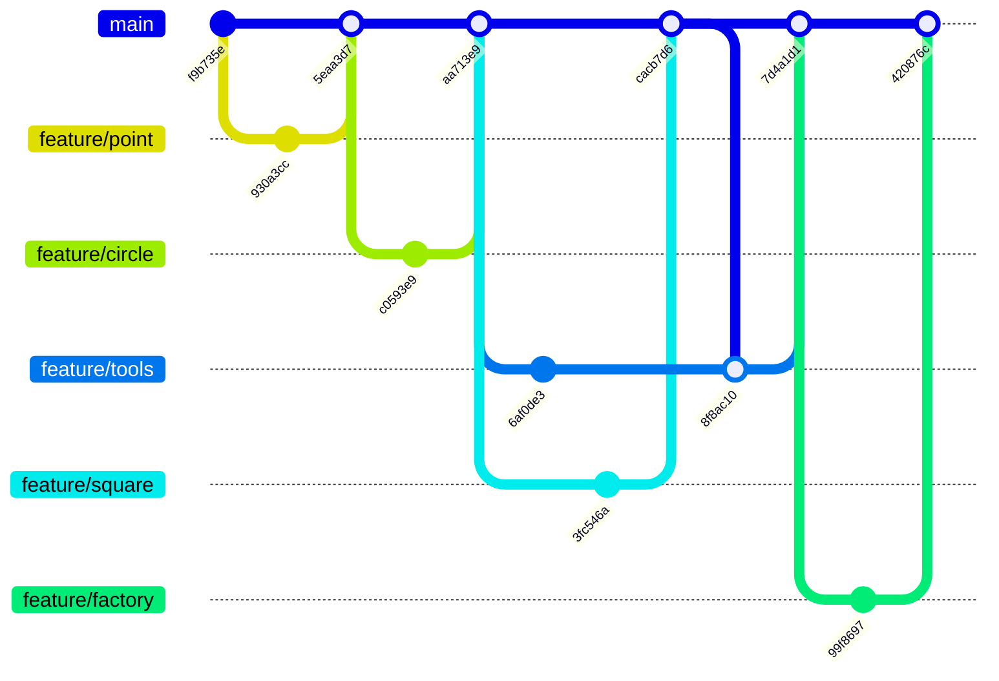

# GraphicEditor

Две версии программы находятся в существующих ветках:

| Ветка | Версия и возможности |
|---|---|
| [`increment1`](https://github.com/PROCuuuba/GraphicEditor/tree/increment1) | Первый инкремент, 0.1.0: точка, круглая и квадратная кисти |
| [`increment2`](https://github.com/PROCuuuba/GraphicEditor/tree/increment2) | Второй инкремент, 0.2.1: полигоны, заливка, контур, тень и редактируемые PNG проекты |

Выбрать первую версию: `git switch increment1`. Выбрать вторую:
`git switch increment2`. В обеих ветках запуск: `./mvnw javafx:run`.
После переключения для полной проверки используйте `clean verify`, чтобы
убрать результаты сборки другой версии.

Первый инкремент восстановлен отдельным коммитом после прежней публикации
второго. Ветки переименованы: `main` → `increment1`,
`codex/increment-2` → `increment2`. История разработки и тег `v0.2.0` сохранены.
Для работы со вторым инкрементом переключайтесь в `increment2`.

Учебный графический редактор на JavaFX. Текущий этап — первый инкремент:
растровое рисование точками, круглой и квадратной кистью.

Возможности: реализованы точка, круг и квадрат; добавлены инструменты
создания графических элементов, выбор цвета и размера кисти, очистка холста.

Размер круглой/квадратной кисти — от 1 до 100 пикселей. Точка — 1 пиксель.
Выбор цвета влияет на новые штрихи, уже созданные элементы сохраняются.

Для запуска нужен JDK 25:

```sh
./mvnw javafx:run
```

Проверки модели и контроллера: `./mvnw test`.
Все проверки, включая JavaFX (нужен рабочий стол):
`./mvnw -DexcludedGroups= clean verify`.

Проверка 2026-10-29: 45 тестов, включая JavaFX, без сбоев, ошибок и пропусков.

Первый инкремент был реализован локально до выполнения Git-практики.
Исходная история сохранена. Ветки feature/point, feature/circle,
feature/square, feature/tools и feature/factory используются для настоящих
доработок, проверок и изучения PR, review и слияния. Они не выдаются за
историю первоначального написания уже готовых классов.

## История Git-практики

Схема соответствует реальным коммитам и слияниям:



Каждая ветка прошла Pull Request и самопроверку кода. Конфликт README
между feature/square и feature/tools возник при настоящем слиянии и
разрешён коммитом 8f8ac10. Review одним автором оформлен комментарием:
GitHub не позволяет одобрить собственный Pull Request.
