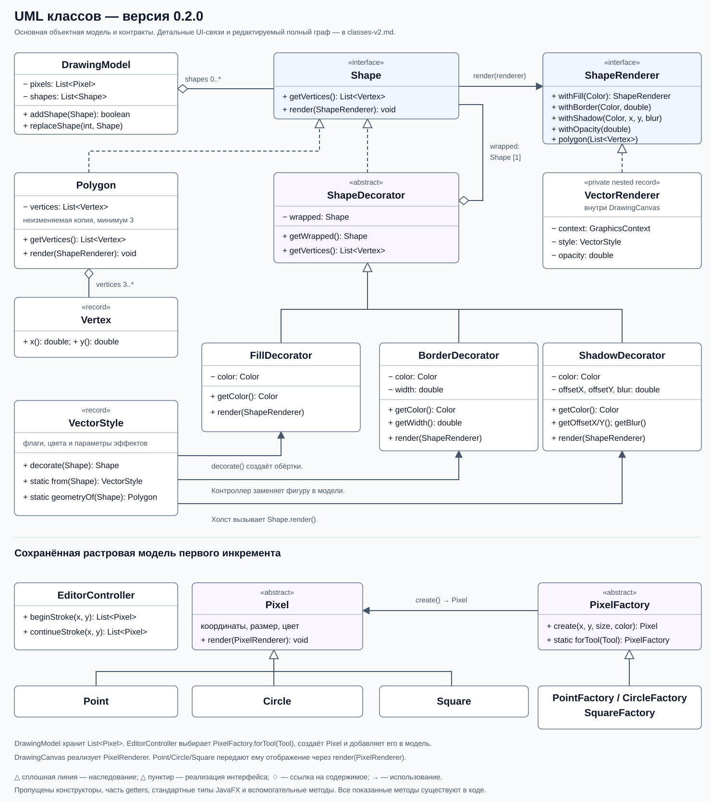
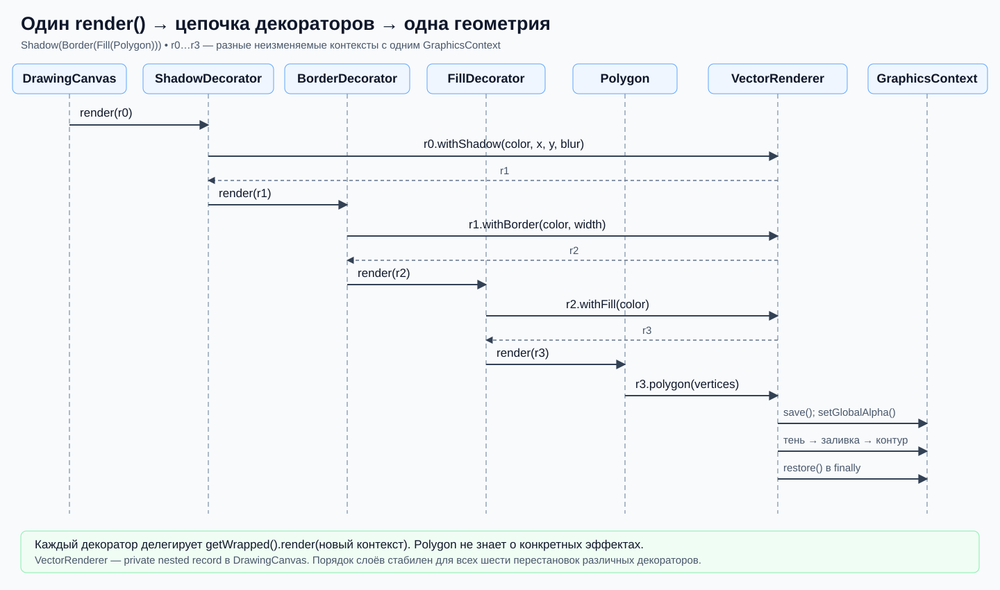
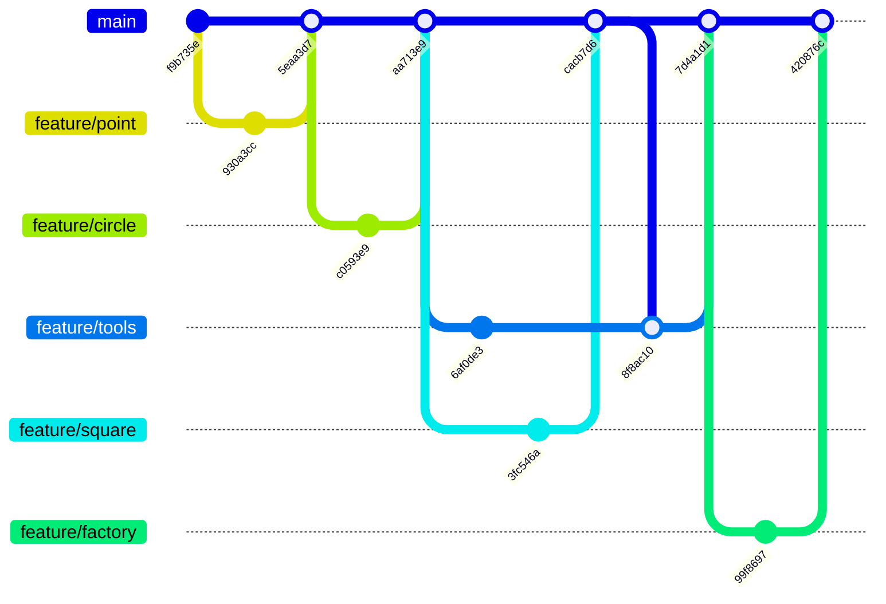

# GraphicEditor

## Назначение

Учебный графический редактор на JavaFX, версия **0.2.1**. Реализованы первый
и второй инкременты [задания](https://github.com/olgmina/SWEngineering-technics.github.io/blob/gh-pages/Labs/prTask_GraphEditor.md):
растровое рисование и векторные полигоны с независимо подключаемыми заливкой,
контуром и тенью. Второй инкремент дополнен сохранением и открытием
редактируемого проекта в PNG.

## Две версии программы

| Существующая ветка | Версия | Возможности |
|---|---|---|
| [`increment1`](https://github.com/PROCuuuba/GraphicEditor/tree/increment1) | 0.1.0, первый инкремент | Точка, круглая и квадратная кисти, цвет, размер и очистка |
| [`increment2`](https://github.com/PROCuuuba/GraphicEditor/tree/increment2) | 0.2.1, второй инкремент | Всё из первого, полигоны, оформление, масштаб и редактируемые PNG |

Для первой версии выполните `git switch increment1`, для второй —
`git switch increment2`. После переключения запуск одинаков:
`./mvnw javafx:run`. Перед переключением сохраните собственные изменения.
История прежнего объединения инкрементов сохранена; текущие ветки содержат
две отдельные версии программы.

## Возможности

- Рисование точкой, круглой или квадратной кистью с выбором цвета.
  Размер круглой/квадратной кисти — 1–100 логических пикселей, точки — 1 пиксель.
  Цвет и размер меняют новые штрихи, не уже нарисованные элементы.
- Полигоны из не менее трёх вершин, привязка к существующим вершинам,
  замыкание нажатием первой вершины и перетаскивание вершин готовой фигуры.
- Независимые заливка, цвет и толщина контура, цвет, смещение и размытие тени.
  Оформление выбранного готового полигона изменяется сразу.
- Несколько полигонов, выбор в списке, удаление выбранной фигуры и очистка
  всего рисунка. Растровые элементы отображаются под векторными.
- Масштаб 25–400%, автоматическое вписывание и центрирование при изменении
  окна, колесо мыши, жесты прокрутки и сведения/разведения пальцев.
- Встроенные всплывающие подсказки и горячие клавиши.
- Открытие и сохранение PNG проекта с сохранением растровых элементов,
  вершин полигонов и их оформления для дальнейшего редактирования.

Холст имеет постоянный логический размер 900×650. Масштаб изменяет только
отображение, не координаты рисунка. Группы объектов, сохранение настроек
приложения и Undo/Redo не реализованы; третий инкремент целиком не выполнен.

## Требования и запуск

Нужен **JDK 25** и графический рабочий стол. JavaFX **21.0.6**, JUnit **5.12.1**
и Maven **3.8.5** загружаются через зависимости и Maven Wrapper; отдельная
установка JavaFX или Maven не требуется. При первой сборке нужен интернет.
В IntelliJ IDEA выберите JDK 25 как SDK проекта и импортируйте `pom.xml`.

Из корня проекта:

```sh
./mvnw javafx:run
```

На Windows используйте `mvnw.cmd javafx:run`.

Проверки без запуска окон:

```sh
./mvnw test
```

Полная проверка, включая сцены JavaFX, события ввода, снимки холста и
регрессию первого инкремента (нужен графический рабочий стол):

```sh
./mvnw -DexcludedGroups= clean verify
```

Покрытие требований и ограничения проверки указаны в
[контрольной карте второго инкремента](docs/checks-increment-2.md).

## Управление

В верхней части окна находятся кнопки **«Открыть PNG…»** и
**«Сохранить PNG…»**. Сохранение предлагает выбрать имя и место файла;
открытие восстанавливает проект из выбранного PNG. Если на холсте есть
рисунок, программа запрашивает подтверждение его замены. Файл сначала
проверяется: ошибка чтения или отказ от замены сохраняют текущий рисунок.

В режиме «Полигон» задайте вершины кликами. После третьей вершины нажмите
первую вершину, «Завершить полигон» или Enter. Привязка действует в радиусе
10 экранных пикселей и сохраняет точные координаты вершины. Escape или
«Отменить вершины» сбрасывает черновик.

Выберите готовую фигуру в списке: изменение параметров заливки, контура и
тени сразу меняет только её. «Применить оформление» также доступно, но не
обязательно. Во время создания черновика настройки относятся к новой фигуре,
а не к ранее выбранной. Для изменения геометрии зажмите вершину готовой
фигуры и переместите мышь; Escape отменит текущий жест. Клик по существующей
вершине без перемещения начинает новый полигон с привязкой.

Колесо мыши и жест прокрутки масштабируют вокруг курсора. Сведение/разведение
пальцев использует событие масштаба JavaFX. Shift + колесо оставляет прокрутку.
Ручной масштаб сохраняется при изменении окна; «Вписать» вновь включает
автоматическое вписывание. Работа аппаратных жестов зависит от устройства и
от того, передаёт ли его драйвер события в JavaFX.

| Клавиши | Действие |
|---|---|
| Ctrl/Cmd + O / S | Открыть / сохранить PNG проекта |
| 1 / 2 / 3 | Точка / круг / квадрат |
| P / B | Полигон / кисти |
| Enter / Escape | Завершить / отменить создание полигона |
| Delete / Backspace | Удалить выбранный полигон |
| Ctrl/Cmd + Enter | Применить оформление |
| Ctrl/Cmd + `+` / `−` | Увеличить / уменьшить |
| Ctrl/Cmd + 0 / 9 | 100% / автоматическое вписывание |
| Ctrl/Cmd + Shift + Delete или Backspace | Очистить холст |

Клавиши редактора не перехватывают ввод в текстовые поля и элементы выбора.

## Как устроен PNG проекта

Один файл содержит две части. Обычное изображение PNG размером 900×650
показывает законченный рисунок в просмотрщиках. В стандартном текстовом
блоке PNG `iTXt` с ключом `GraphicEditor.Project` дополнительно хранится
XML с версией формата проекта: типы, координаты, цвета и размеры элементов
кисти, а также вершины полигонов и параметры заливки, контура и тени.
Вспомогательные маркеры выделения не относятся к изображению проекта.

При открытии редактор читает XML и восстанавливает объекты модели.
Поэтому можно выбрать прежний полигон, передвинуть его вершины и изменить
оформление. Данные кистей также восстанавливаются как исходные элементы,
а не как единая картинка; инструменты их отдельного изменения остаются
такими же, как до сохранения.

Это тот же принцип встраивания описания документа в картинку, который
используют редакторы вроде draw.io, но формат GraphicEditor собственный:
совместимость с файлами проектов draw.io не заявлена. Обычный PNG без
`GraphicEditor.Project` открытию как проект не подлежит: программа выдаёт
понятную ошибку и сохраняет текущий холст. Превращение произвольной
картинки в редактируемые фигуры не выполняется.

Передавайте **исходный PNG файлом**. Сторонние редакторы, оптимизаторы и
мессенджеры могут удалить метаданные: изображение останется видимым,
но открыть его как редактируемый проект после этого не получится.

## Структура проекта

```text
src/main/java/org/example/graphiceditor/
├── controller/          управление штрихами, полигонами и выбором
├── factory/             фабричный метод для растровых элементов
├── io/                  PNG проекта и XML с версией формата
├── model/               растровая модель и общая коллекция объектов
│   └── vector/          Polygon, Shape, декораторы и VectorStyle
└── ui/                  JavaFX-панель, отрисовка и масштабируемый холст
src/main/resources/      стили интерфейса
src/test/java/           модульные, интеграционные и GUI-проверки
docs/uml/                UML и редактируемые Mermaid-источники
docs/images/             архитектурная схема и её источник
README.md                назначение, запуск и управление
CHANGELOG.md             история продукта
```

Тесты размещены в стандартном Maven-каталоге `src/test/java`, не в отдельном
корневом `test/`. Результаты сборки и настройки IDE исключены из Git.

## Архитектура


`EditorPane` связывает элементы интерфейса с `EditorController` и
`PolygonController`. `DrawingModel` хранит объекты, а `DrawingCanvas` только
отображает их. `CanvasViewport` масштабирует представление, не изменяя модель.
Пакет `io` сохраняет модель в XML внутри PNG и восстанавливает её после
проверки файла. Растровый снимок для PNG строится без изменения масштаба
рабочего холста. Схемы ниже описывают базовую архитектуру версии 0.2.0;
пакет ввода-вывода добавлен в 0.2.1.

Растровые элементы наследуют абстрактный `Pixel`; создание конкретного типа
вынесено в подклассы `PixelFactory`. Векторный `Polygon` хранит неизменяемую
геометрию. `ShapeDecorator` содержит ссылку на `Shape`, а конкретные декораторы
делегируют вызов следующему объекту с дополненным `ShapeRenderer`.



Приватный вложенный `DrawingCanvas.VectorRenderer` накапливает свойства
в неизменяемых контекстах. После обхода цепочки он рисует тень, заливку и контур
в стабильном порядке независимо от порядка обёрток.



## Документация и история изменений

- [Архитектура и её Mermaid-источник](docs/images/architecture-v2.md).
- [UML классов и связи с исходниками](docs/uml/classes-v2.md).
- [UML последовательности и описание контекста отрисовки](docs/uml/sequence-v2.md).
- [Карта требований и проверок второго инкремента](docs/checks-increment-2.md).
- [CHANGELOG](CHANGELOG.md).

## История Git-практики

Первый инкремент был реализован локально до выполнения Git-практики.
Исходная история сохранена. Ветки `feature/point`, `feature/circle`,
`feature/square`, `feature/tools` и `feature/factory` использовались для настоящих
доработок, проверок и изучения PR, review и слияния. Они не выдаются за
историю первоначального написания уже готовых классов.

Схема соответствует реальным коммитам и слияниям:



Каждая ветка прошла Pull Request и самопроверку кода. Конфликт README
между feature/square и feature/tools возник при настоящем слиянии и
разрешён коммитом 8f8ac10. Review одним автором оформлен комментарием:
GitHub не позволяет одобрить собственный Pull Request.

Первоначальная реализация второго инкремента и пользовательские доработки
также сначала были сделаны локально: `dd0aed9`, `55c6a66`, `11219cb`.
Публикация, задачи, функциональные ветки и PR оформлены при итоговой
проверке. Это фактическая последовательность, а не восстановленная задним
числом история разработки. Полная история изменений доступна в Git и
Pull Request репозитория.

Задачи публикации и проверки второго инкремента:

| Задача | Функциональная ветка | Pull Request |
|---|---|---|
| [#6 — полигон](https://github.com/PROCuuuba/GraphicEditor/issues/6) | `codex/polygon` | [#12](https://github.com/PROCuuuba/GraphicEditor/pull/12) |
| [#7 — заливка](https://github.com/PROCuuuba/GraphicEditor/issues/7) | `codex/fill` | [#13](https://github.com/PROCuuuba/GraphicEditor/pull/13) |
| [#8 — контур](https://github.com/PROCuuuba/GraphicEditor/issues/8) | `codex/border` | [#15](https://github.com/PROCuuuba/GraphicEditor/pull/15) |
| [#9 — тень](https://github.com/PROCuuuba/GraphicEditor/issues/9) | `codex/shadow` | [#14](https://github.com/PROCuuuba/GraphicEditor/pull/14) |
| [#10 — документация и выпуск](https://github.com/PROCuuuba/GraphicEditor/issues/10) | `codex/increment-2` | [#11](https://github.com/PROCuuuba/GraphicEditor/pull/11) |

Общий [PR #11](https://github.com/PROCuuuba/GraphicEditor/pull/11) связывает
второй инкремент с основной веткой. Статус проверки и слияния следует смотреть
в GitHub; эта таблица не подменяет фактическую историю Git.

Функциональные PR объединены в `codex/increment-2`, затем общий PR направляет
проверенный инкремент в `main`. Опубликованная версия фиксируется тегом и
[Release v0.2.0](https://github.com/PROCuuuba/GraphicEditor/releases/tag/v0.2.0).

Эти PR и тег описывают публикацию 0.2.0 с прежними именами веток.
При разделении версий первый инкремент восстановлен отдельным коммитом.
Затем ветки переименованы: `main` → `increment1`,
`codex/increment-2` → `increment2`. Текущие версии находятся в `increment1`
и `increment2`; прежние коммиты и тег не переписаны.
