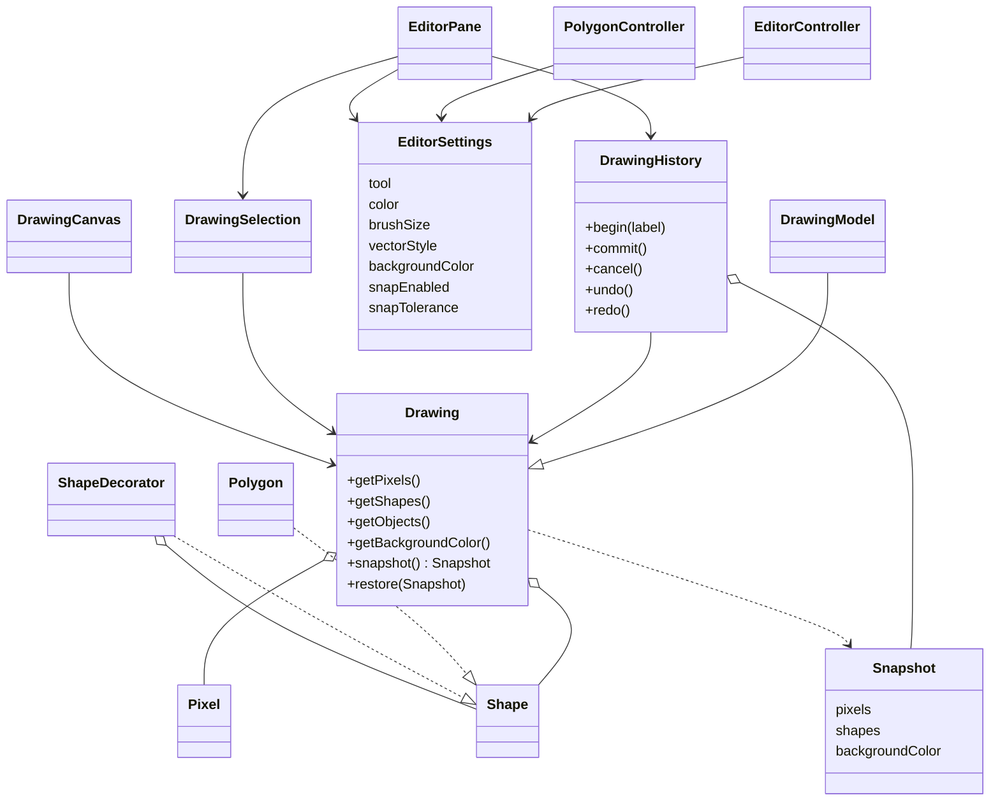
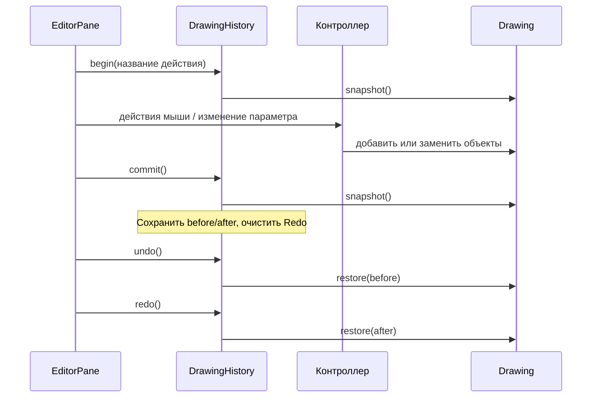
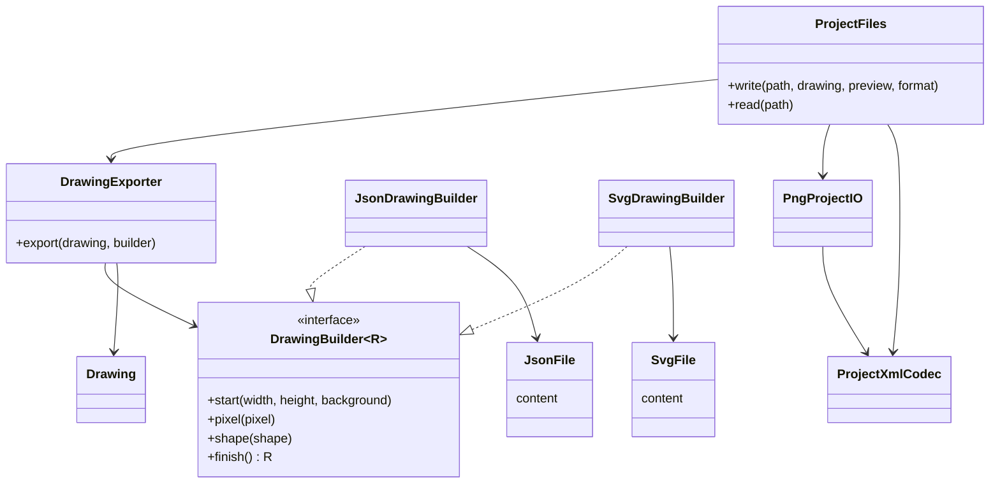
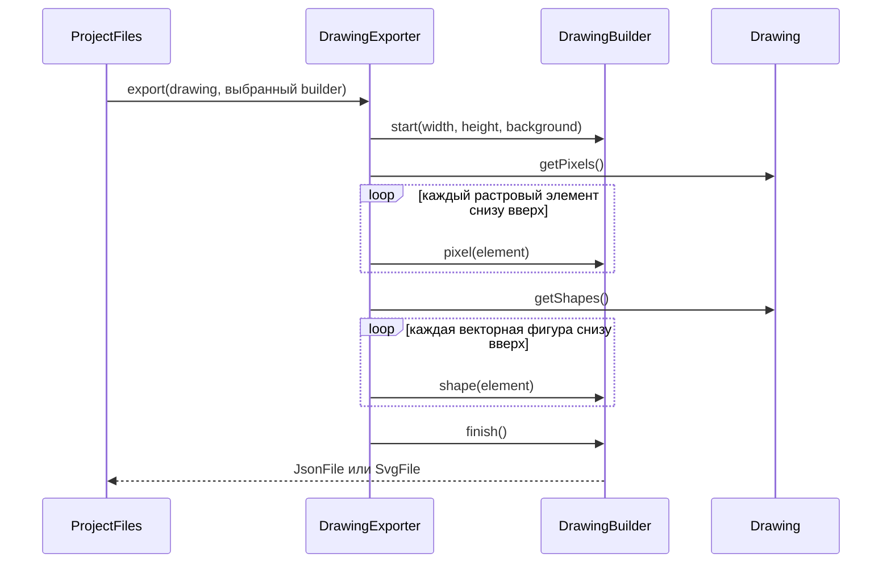

# Архитектура версии 1.0.1

Третий инкремент объединяет рисунок, историю, настройки и работу с файлами.
Фабричный метод и декораторы сохраняют роли из предыдущих версий.
Исходники диаграмм находятся прямо в этом Markdown и отображаются GitHub.

## Модель и действия

`Drawing` хранит состав и фон, без знания расширений файлов или синтаксиса
экспорта. `DrawingModel` наследует его для совместимости со старым кодом.
Растровые элементы располагаются под векторными; порядок внутри каждого
слоя сохраняется. Настройки инструмента и привязки находятся в общем
`EditorSettings`, фон дополнительно является свойством документа.

Элементы кисти, вершины и цепочки декораторов неизменяемы. При редактировании
объект заменяется. `Drawing.Snapshot` сохраняет неизменяемые списки ссылок,
поэтому последующие изменения рисунка не меняют старый снимок. История
хранит состояния до и после завершённой операции; это Memento, а не снимок
растрового холста. Undo не теряет структуру редактируемых фигур.

Один штрих и один жест перемещения образуют по одной операции.
Отмена незавершённого жеста восстанавливает его начало. Новая правка
после Undo удаляет альтернативное продолжение Redo. История ограничена
100 действиями и сбрасывается при создании или открытии документа.

## Форматы и Builder

`DrawingExporter` выступает директором: начинает документ, последовательно
передаёт растровые элементы, затем векторные фигуры, завершает сборку.
`DrawingBuilder<R>` разделяет алгоритм обхода и синтаксис результата.
`JsonFile` и `SvgFile` — отдельные записи без общей предметной иерархии.
Настройка нового формата не требует изменений модели или примитивов.

Сборка идёт по объектам, без промежуточной копии всего рисунка в общей
текстовой модели. Готовый результат формата всё ещё занимает память;
пошаговая сборка не означает произвольный размер проекта без ограничений.

`ProjectFiles` выбирает PNG, JSON или SVG. PNG содержит обычное превью
и XML в `iTXt` с ключом `GraphicEditor.Project`. SVG содержит отображаемые
примитивы и встроенное описание модели. JSON хранит структурированные
параметры объектов.
Фон, геометрия, цвета и порядок декораторов восстанавливаются во всех форматах.

Позднее архитектурное дополнение задания требует JSON/SVG и независимых
продуктов Builder. Реализованы JSON и SVG, а также PNG с данными проекта.

Чтение и проверка выполняются до замены текущего рисунка. История и
параметры текущего инструмента не сериализуются. Отдельные вложенные группы
с собственным пользовательским управлением не вводятся: составным объектом
документа служит `Drawing`.

## Связь с предыдущими артефактами

[Диаграммы классов](uml/classes-v2.md),
[отрисовка декораторов](uml/sequence-v2.md) и
[архитектура 0.2.0](images/architecture-v2.md) сохраняют описание второго
инкремента. Новые связи модели, истории, настроек и файлов представлены
здесь; старые схемы не выдаются за полную архитектуру 1.0.1.
