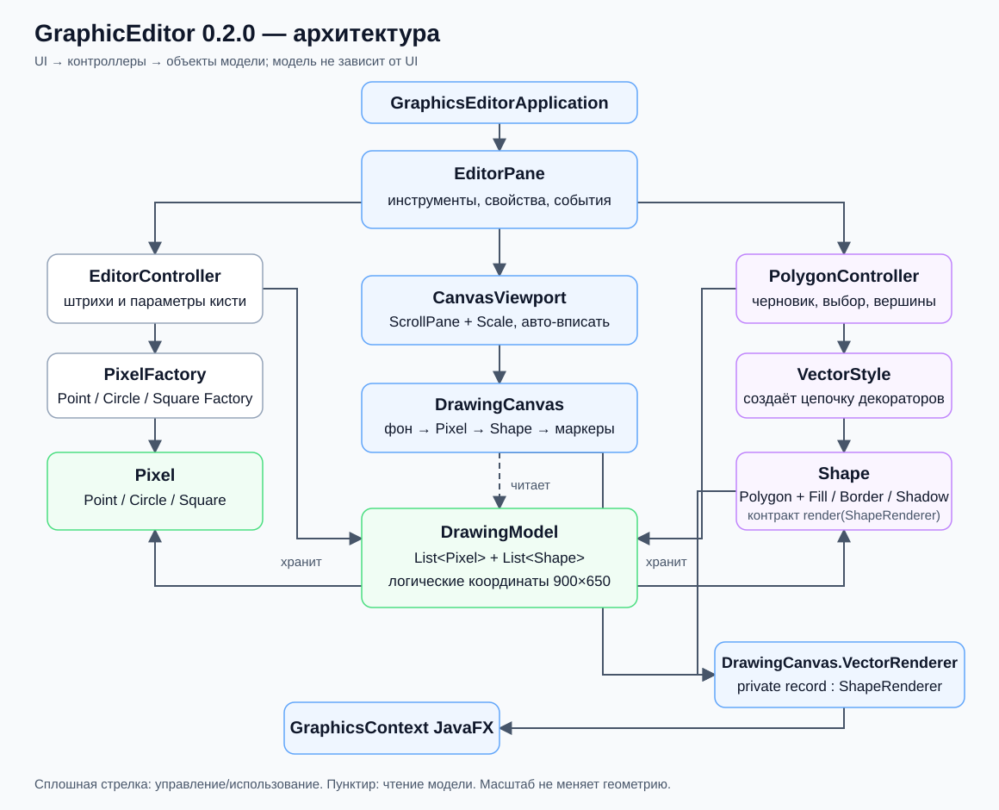
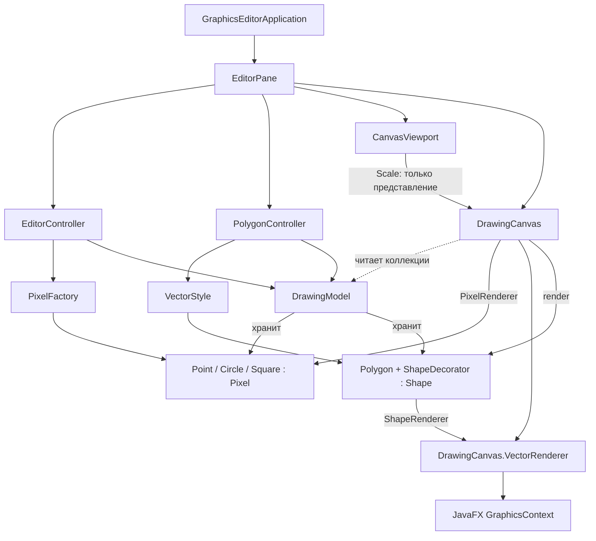

# Архитектура 0.2.0

Схема отражает текущий код. Сплошные стрелки показывают управление и
использование объектов; пунктирные — чтение модели при отображении.
`DrawingModel` не вызывает UI и не знает о масштабе.

Контроллер растрового режима создаёт объекты через фабрику и записывает их в
модель. Контроллер полигонов хранит черновик и выбор, создаёт `Polygon` и
оборачивает его выбранными декораторами. При изменении геометрии или стиля
готовая фигура заменяется в модели, а не изменяется внутри `Polygon`.

`DrawingCanvas.renderAll()` рисует белый фон, растровые элементы, полигоны и
служебные маркеры. `CanvasViewport` оборачивает Canvas в JavaFX-контейнеры
для прокрутки и масштаба; размер модели остаётся 900×650.
