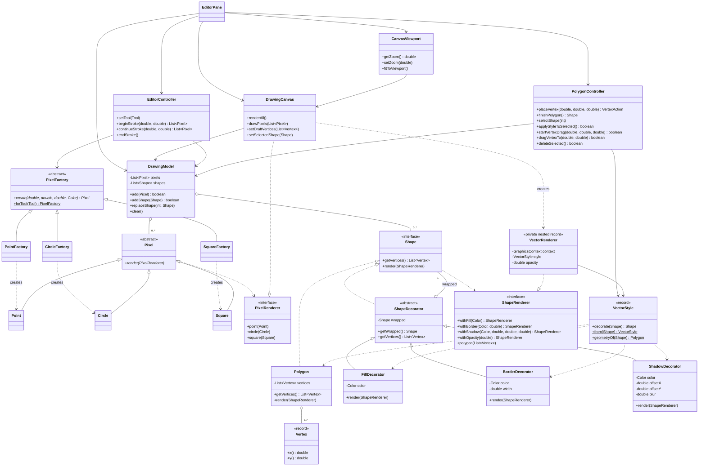

# UML классов 0.2.0

Показаны основные классы и методы двух инкрементов. Элементы JavaFX,
вспомогательные UI-поля, конструкторы и обычные getters опущены.
Методы и связи соответствуют исходникам, а не примерным именам из методички.

`ShapeDecorator` реализует `Shape`, но оставляет `render()` конкретному
декоратору. Каждый декоратор имеет ровно одну ссылку `wrapped` на `Shape`;
она может указывать как на `Polygon`, так и на другой декоратор.

`VectorRenderer` — приватный вложенный record в `DrawingCanvas`, не отдельный
публичный класс. `VectorStyle` — неизменяемые параметры и адаптер между
элементами управления и цепочкой декораторов, не подкласс `Shape`.

Расширяемость проверяется тестовым `TransparencyDecorator` в
`ShapeDecoratorTest`: он наследует `ShapeDecorator` и вызывает
`renderer.withOpacity()` без изменения `Polygon`. В пользовательском
интерфейсе отдельного инструмента прозрачности нет.
